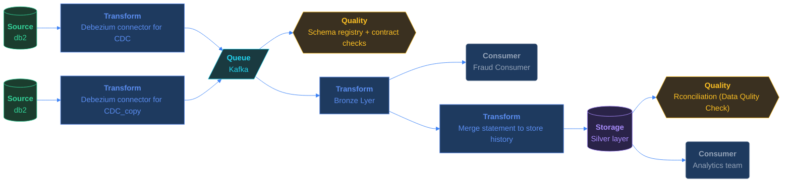

# Two Ways to Catch a Change

*Two ways to watch the database. Each has a cost.*

[Pipeline Architecture · Medium · on DataDriven](https://datadriven.io/problems/two_ways_to_catch_a_change)

## How it went

| | |
|---|---|
| Solved | 2026-11-19 |
| Accepted | on the first submission |
| Hints | none |
| Concepts | Batch vs Streaming, Change Data Capture, Data Quality & Validation, Dead Letter Queues, Deduplication Strategies, Event-Driven Architecture, Event Streaming Platforms, Full vs Incremental Load, Idempotency, Kappa Architecture, Pipeline Monitoring, Retry & Failure Handling, Schema Evolution, Stream Processing |

## The design

The whole design, with every component's settings, the connections, the zones and where each sits on the canvas, is in [`architecture.json`](./architecture.json).
